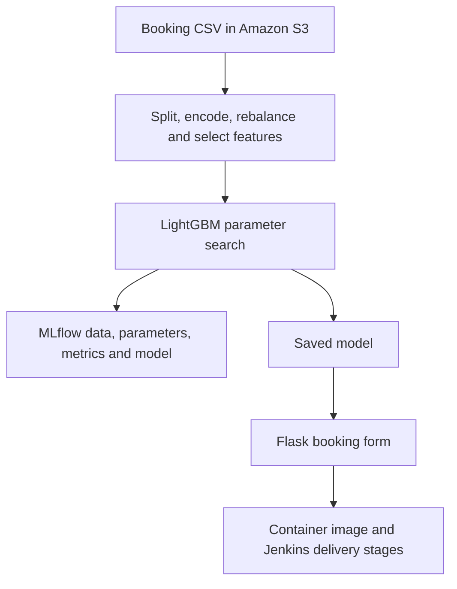

# Hotel Cancellation Predictor
### From reservation data to a trained model, a web form, and a delivery pipeline.

N.B : The project demonstrates the general workflow of a solid machine learning project. However, it may contain some imperfections, such as a potential data leakage issue during the validation phase, before testing. This aspect was taken into consideration in the CI/CD pipeline.

A hotel needs to anticipate which reservations may be cancelled before the arrival date. This project trains a cancellation classifier from booking records and exposes a saved LightGBM model through a Flask form. It also defines Jenkins stages for packaging the application, pushing an image to Amazon ECR, and requesting an ECS service rollout.

**Try the booking workflow:** enter a lead time of 30 days, one special request, a room price of 100, and a stay of two week nights plus one weekend night. Select an arrival date, market segment, room type, and meal plan, then click **Predict**. The interface displays a cancellation or non-cancellation label. This is a classification example, not a guaranteed booking outcome; see the input contract below before interpreting form results.

## Three parts worth following

### 1. Turn booking records into model inputs

[Ingestion](src/data_ingestion.py) downloads `HotelReservations.csv` from the S3 bucket configured in [config.yaml](config/config.yaml), then saves an 80/20 train/test split. [Preprocessing](src/data_preprocessing.py) removes booking identifiers and duplicates, encodes categories, applies `log1p` to sufficiently skewed numeric columns, and uses **SMOTE on the training set** to rebalance cancellation classes.

A Random Forest ranks feature importance and selects ten columns. The test frame is then aligned to those selected columns. The result is a pair of processed CSVs that makes the handoff to training easy to inspect.

### 2. Keep the experiment's inputs and outputs together

[Training](src/model_tranning.py) uses `RandomizedSearchCV` to tune a LightGBM classifier. The checked-in configuration runs two sampled parameter combinations with two-fold cross-validation and accuracy as the search objective.

Each MLflow run records the processed train/test CSVs, selected model parameters, accuracy, weighted precision, weighted recall, weighted F1, and the saved model artifact. A reviewer can inspect what a run consumed and produced rather than relying on a score copied into a README. The [exploration notebook](notebook/mlops-hotelReservation.ipynb) shows the earlier data analysis and model-selection work.

**Notebook context.** The notebook records the experimentation phase, including steps refined in the pipeline implementation. For example, it applies SMOTE before splitting the data, while the [training pipeline](pipline/training_pipline.py) splits first and [preprocessing](src/data_preprocessing.py) resamples only the training set. Use these scripts as the reference for the implemented workflow.

### 3. Separate the prediction interface from delivery automation

[Flask](app.py) loads `artifacts/model/LGBM_model.pkl` and renders the prediction in the [booking form](templates/index.html). The [Jenkinsfile](Jenkinsfile) defines selectable stages for checkout, environment setup, ECR image build/push, and ECS deployment commands. This connects the model artifact to an application and an explicit delivery workflow.



Training is invoked by the container build recipe; the Jenkinsfile itself has no separate training stage. The cloud configuration documents a delivery path, not evidence of a currently running public endpoint.

## Run the web interface locally

Prerequisites: Git, Python 3.10 (matching the container image), and a virtual environment. LightGBM may require a platform-specific OpenMP runtime; the container installs `libgomp1`.

```bash
git clone https://github.com/Jabour-Salahddine/MLOPS-HotelReservation.git
cd MLOPS-HotelReservation
python -m venv .venv
source .venv/bin/activate
python -m pip install -e .
python app.py
```

On Windows PowerShell, activate with `.\.venv\Scripts\Activate.ps1`. Run commands from the repository root so the configured artifact paths resolve. The saved model and example CSV artifacts are included. Open **http://localhost:5000** to inspect the form; the development server runs with Flask debug mode enabled.

### Model input contract

The saved model's feature names and the processed CSV headers use this order:

```text
lead_time, no_of_special_requests, avg_price_per_room,
arrival_month, arrival_date, market_segment_type,
no_of_week_nights, no_of_weekend_nights,
room_type_reserved, type_of_meal_plan
```

The current form adapter sends meal plan before room type, reversing the final two positions. Use the saved model's named feature order when examining predictions; form results need that adapter alignment before they can be treated as validated predictions. The template maps `0` to cancellation and `1` to non-cancellation.

Preprocessing currently fits category encoders and skewness decisions separately on train and test data, and saves the estimator rather than a shared preprocessing object. Interpret logged metrics in that implementation context; new input data must use the same encodings and transformations as the model's training inputs.

## Re-run training

The included artifacts can be inspected locally. To reproduce the full ingestion-to-training path, use your own AWS credentials or an IAM role with S3 read access, update the bucket and object in `config/config.yaml`, and run:

```bash
python -m pipline.training_pipline
mlflow ui --port 5001
```

Open http://localhost:5001 to inspect local runs. Training overwrites the processed CSVs and saved model. To re-run only training/evaluation from the included processed CSVs:

```bash
python -m src.model_tranning
```

The module names above match the existing `pipline/` and `model_tranning.py` paths.

## Container and Jenkins setup

```bash
docker build -f dockerfile -t hotel-cancellation .
docker run --rm -p 5000:5000 hotel-cancellation
```

The image build invokes the full training pipeline, including S3 ingestion. It needs access to the configured data or the existing local data artifacts; the recipe does not explicitly forward the Jenkins agent's AWS credentials into the build. Check ingestion logs to distinguish a fresh download from a run using existing artifacts. Do not bake credentials into an image.

For Jenkins, provide Docker, Python, the AWS CLI, and the credentials referenced by the pipeline (`github-token`, `aws-access-key`, `aws-secret-key`). Adapt the ECR repository, AWS region, and ECS resource names to your account. The ECS cluster, service, and task definition must already exist. `STAGE_TO_RUN` selects the stages to execute; the workspace and prerequisites must exist when running a later stage alone.

The deployment stage registers a task-definition revision and forces an ECS service redeployment, but does not pass that new revision to `update-service`. Verify the service's active revision when assessing a rollout.

## Code map and credits

| Open | What to inspect |
| --- | --- |
| [config/](config/) | S3 input, feature-selection settings, search space, and artifact paths |
| [src/](src/) | Ingestion, preprocessing, model training/evaluation, and logging |
| [artifacts/](artifacts/) | Example data splits, processed features, and saved estimator |
| [Jenkinsfile](Jenkinsfile) | Selectable build, push, and deployment stages |

Developed by **Salahddine Jabour**. The existing interface is credited as **Hotel Predictor App, 2025**. Training input is configured as `HotelReservations.csv`; see the checked-in configuration and example artifacts for the booking schema.
